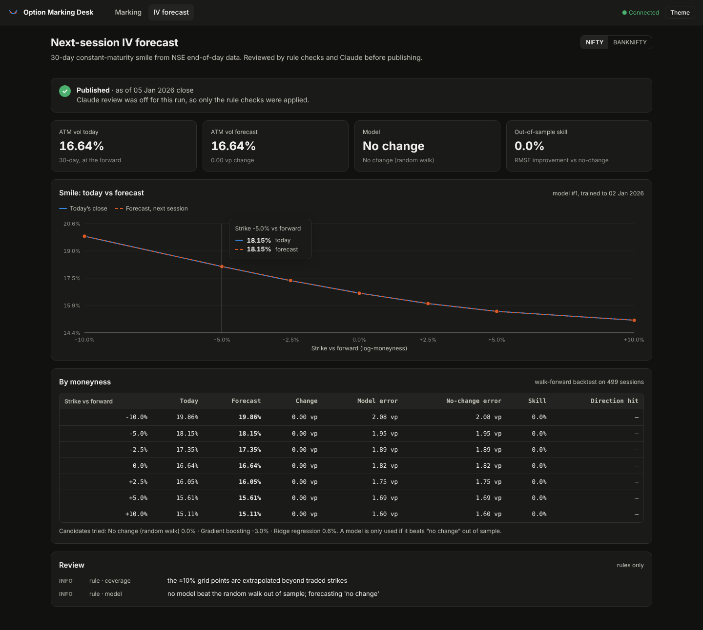

# Next-session IV forecast



*Shown on synthetic data with the Claude review switched off: no model beat "no change", so that is what is published.*

Code: `app/forecast/`. The daily job runs after NSE publishes the F&O bhavcopy:

```
bhavcopy (NSE, free) ─► contracts table ─► daily SVI fits ─► 30-day smile on a moneyness grid
      ─► features ─► model (re-trained weekly, only if it beats "no change") ─► forecast
      ─► rule checks ─► Claude review on Bedrock ─► publish (pass / warn) or hold (block)
```

## What is forecast

The forecast is tomorrow's **30-day constant-maturity implied-vol smile** at seven points of log-moneyness `k = ln(K/F)`: −10%, −5%, −2.5%, 0, +2.5%, +5%, +10%.

- **Why fixed moneyness:** strikes drift as the index moves, but a fixed-moneyness smile is a stable thing to learn. A forecast for any strike comes from interpolating it at that strike's `k`.
- **Why 30 days:** it removes the day-to-day roll from one expiry to the next. It's built by interpolating total variance between the two expiries that bracket 30 days.

**Target:** the change from today's close to the next session's close at each grid point.

## Data → smile

| Step | Rule |
|---|---|
| Contracts | index options (IDO) and futures (IDF) for each symbol from the UDiFF bhavcopy |
| Forward | same-expiry future settle (monthlies), else put-call parity on traded pairs, else spot carry |
| Quotes used | out-of-the-money, traded today (volume ≥ 10), close ≥ ₹0.5, \|k\| ≤ 25% |
| Fit | raw SVI per expiry, weighted by √volume, butterfly-arbitrage penalty only if needed, warm-started from yesterday |
| Diagnostics stored | points used, fit RMSE, arbitrage flag, grid coverage, forward source, volume, put/call ratio |

Bhavcopy has closing prices, not bid/ask, so this uses *traded today* as its liquidity test. The marking engine in `app/quant/marking.py` uses quotes.

## Features

The features cover:
- **Smile state:** today's smile (7 points), skew, wing, curvature.
- **Recent moves:** 1- and 5-day changes in ATM vol and skew, ATM vs its 60-day mean.
- **The index:** 1- and 5-day returns, 10- and 20-day realised vol, and the gap between implied and realised vol (the variance risk premium).
- **Activity and calendar:** days to the front expiry, volume relative to its 20-day average, put/call volume ratio, day of week, and the calendar gap to the next session (weekends and holidays).

## Models and the "no change" rule

Three candidates are compared:

| Model | |
|---|---|
| `rw` | random walk: tomorrow = today. The baseline to beat. |
| `ridge` | standardised ridge regression, regularisation chosen by leave-one-out CV |
| `gbr` | gradient-boosted trees, shallow and regularised |

**Walk-forward backtest:** fit on all data up to day *i*, predict the next 20 sessions, refit and roll forward. Every prediction is out of sample.

**Skill:** `1 − RMSE_model / RMSE_no-change` at each grid point. The best model is used only if its mean skill is **≥ 2%**; otherwise the published forecast is "no change", and the dashboard says so. Retraining is weekly (`MODEL_MAX_AGE_DAYS`).

### What to expect

Daily IV changes are mostly driven by the next day's index move, which can't be known at today's close. The predictable part (mean reversion, the implied-vs-realised gap, calendar effects) is small. On the synthetic test markets:

| Synthetic market | Best model skill | Published |
|---|---|---|
| Realistic dynamics (mean-reverting vol, leverage effect), 2 years | ridge +0.6% | no change |
| Pure random walk (nothing to predict) | negative | no change |
| Strong mean reversion (test of the machinery) | ridge +4.5% (theoretical max ≈ 6%) | ridge |

So the machinery finds signal when it exists and doesn't invent it when it doesn't. **How much skill there is on real NIFTY/BANKNIFTY data is unknown until you backfill and run it.** Expect single-digit percentages at best. Even a small, honest edge in the *skew* or the *weekend* effect is useful for marking and for strangle timing. A large backtest skill is more likely a bug than an edge, so investigate it before trusting it.

## Claude's role: sanity review, not forecasting

The numbers come from the model. Claude (on Amazon Bedrock, Converse API) receives a compact JSON payload of about 1–2k tokens:
- today's, yesterday's and the forecast smile
- the last 10 sessions
- data and fit diagnostics
- model skill and errors
- the rule-check results

It returns a verdict through a `submit_review` tool: status (`pass` / `warn` / `block`), issues with evidence, a summary, and its confidence.

- **The stricter verdict wins.** Claude can add warnings or block a forecast, but it **cannot clear a failed rule check**.
- **It fails closed:** if Bedrock is unreachable or the reply can't be parsed, the forecast is stored as `block` (`REVIEW_REQUIRED=true`). Set it to `false` to publish with a warning instead.
- **Output is treated as data:** it's validated against a schema and shown as text.

### Rule checks (always run first)

| Check | Fails when / warns when |
|---|---|
| freshness | data more than 4 days old (fail) |
| contract_count | below 30% (fail) or 60% (warn) of the 20-day median |
| fit_quality | fit RMSE above 3 vp (fail), above 1 vp or fewer than 10 points (warn) |
| arbitrage / coverage / forward | butterfly arbitrage (warn), extrapolated wings (info), carry forward (warn) |
| iv_jump, spot_jump | ATM moved more than 6× its typical daily change; index moved more than 4% |
| prediction_level / size | forecast vol outside 3%–150% (fail); change more than 2× (fail) or 1× (warn) the larger of 3 × no-change RMSE and 1.5 vp |
| feature_outlier | any feature with \|z\| > 6 against the last 250 sessions |

### Cost

There's one Claude call per symbol per trading day, of roughly 1.5k input and 300 output tokens. That's well under 1M tokens a year for NIFTY + BANKNIFTY. A re-run with no new data skips the call. Every forecast stores its own token counts.

### Bedrock setup

1. **Model access:** in the Bedrock console (ap-south-1), enable access to the Anthropic model you want. First use needs Anthropic's use-case form.
2. **Model ID** (`BEDROCK_MODEL_ID`):
   - `in.anthropic.claude-sonnet-5` (default): the India geo profile, so requests stay in ap-south-1/ap-south-2.
   - `global.anthropic.claude-sonnet-5-5`: Sonnet 5.5 from Mumbai, routed globally.
   - `in.anthropic.claude-haiku-4-5-20251001-v1:0`: cheapest.
3. **Permissions:** the instance role (Terraform) or the `omd-forecast` pod identity (EKS) gets `bedrock:InvokeModel` on that profile and its foundation model only.

## Running it

```bash
# 1. history (run on your machine or the server: NSE blocks some cloud IP ranges)
python -m app.forecast backfill --symbols NIFTY,BANKNIFTY --from 2024-07-08

# 2. backtest + train (prints every model's skill)
python -m app.forecast train --symbols NIFTY,BANKNIFTY

# 3. see exactly what Claude will receive (no API call)
python -m app.forecast payload --symbol NIFTY

# 4. the daily job (what the scheduler runs)
python -m app.forecast run-daily
```

Try it without NSE: `python -m app.forecast synthetic --out /tmp/bhav --days 400`, then pass `--source-dir /tmp/bhav` to `backfill` and `run-daily`. Add `--no-review` to skip Bedrock.

**Scheduling:**
- **EC2:** a systemd timer (`omd-forecast.timer`, installed on deploy) runs Mon–Fri at 20:15 and 22:30 IST. Every instance has the timer, and a Postgres advisory lock lets one do the work.
- **Kubernetes:** a `CronJob` runs at 20:15 IST, with Istio `ServiceEntry`s for NSE and Bedrock.

**Exit codes:** `run-daily` exits with code 2 when a forecast was **blocked**, so alerts can fire on it.

## Caveats

- **The format is assumed.** The bhavcopy parser checks for the UDiFF columns it needs and fails loudly if NSE changes the format. Verify it on your first real download.
- **History starts July 2024.** UDiFF files only exist from then; earlier years use the old bhavcopy format, which needs a second parser.
- **No events calendar yet.** Claude only sees calendar context that's visible in the data. RBI policy dates, the Union Budget and results seasons could be added as inputs.
- **This is research output, not advice.** If you turn forecasts into trade recommendations for others, SEBI's research-analyst and algo-provider rules apply.
